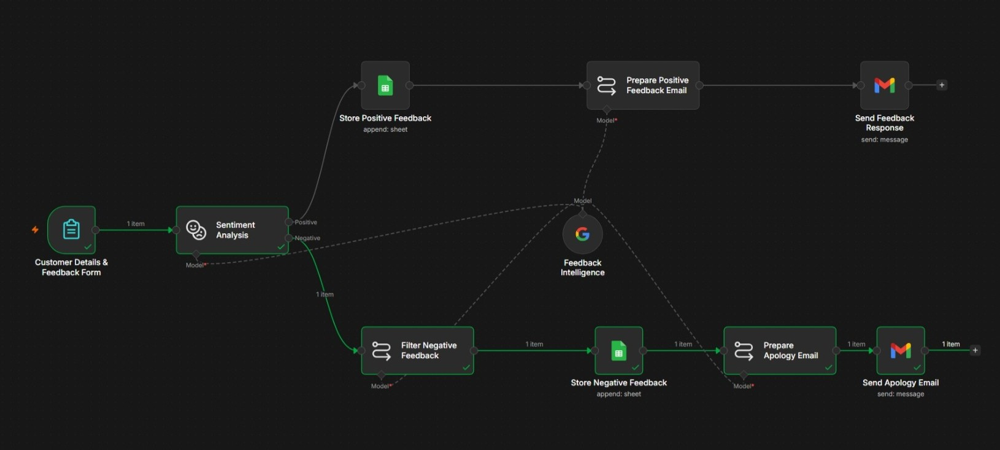

# **Customer Feedback Tracker (n8n Workflow)**


An automated customer sentiment analysis and feedback tracking workflow built with n8n. It captures feedback via Google Forms, classifies sentiment (Positive / Negative) using Google Gemini AI, logs details into organized Google Sheets, and sends automated personalized responses or apologies via Gmail.

## **Workflow Preview**

<p align="center">
  
</p>

## Tech Stack & Nodes Used

| Technology / Node | Purpose |
|-------------------|---------|
| **Form Trigger** | Captures customer submissions |
| **Google Gemini API** | Performs sentiment analysis & extracts key pain points |
| **LangChain ChainLLM** | Generates tailored HTML thank-you and apology emails |
| **Google Sheets** | Stores positive and negative feedback separately |
| **Gmail API** | Sends automated response emails |

## Workflow Execution Flow
<p align="center">
  
</p>

## Setup Instructions

#### 1. Clone this repository
```bash
git clone [https://github.com/hithursan/customer-feedback-tracker-n8n.git](https://github.com/hithursan/customer-feedback-tracker-n8n.git)
cd customer-feedback-tracker-n8n
```
#### 2. Import the Workflow
1. Open your n8n instance.
2. Go to Workflows ➔ Import from File.
3. Select workflow.json.

<h4>3. Configure Credentials</h3>
Set up the following credentials inside n8n:
<ul>
<li>Google Gemini (PaLM) API Key</li>
<li>Google Sheets OAuth2</li>
<li>Gmail OAuth2</li>
</li></ul>

<h4>4. Activate Workflow</h2>
<ul><li>Toggle the status to Active to begin collecting and processing feedback automatically!
</li></ul>

## Project Structure
```
customer-feedback-tracker-n8n/
├── workflow.json              # Cleaned n8n workflow export
├── README.md                  # Project documentation
├── .env.example               # Template for environment variables
└── .gitignore                 # Files to exclude from git
```
## Author
**Hithursan Navaretnarasa**

---
<div align="center" font-wight=800>
Crafted with ❤️ for the modern connoisseu#
</div>
